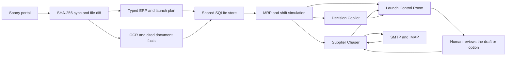

# Soony Launch Control Room

**Team Manti · START Hack Munich 2026 · Lio case "Keep the Line Running"**

Soony's Grand Heist 6 ships Sunday 22 Nov at 20:00 from Hamburg, and the last 20% is not packed. SAP says the launch is fine. Our agents read the messy supplier paperwork (Excel, PDFs, scans in Korean, Chinese, Polish and English), find where SAP is wrong, email the suppliers, and hand Soony's buyers a short list of decisions with the euros at stake. A person approves anything binding.

| For the jury | Link |
|---|---|
| Live product | [soony-manti-live.vercel.app](https://soony-manti-live.vercel.app/) · sign in as `test`, password supplied by the team |
| Pitch deck | [Final PDF](docs/deck/Manti-pitch-deck-final.pdf) · [web version](docs/deck/final/index.html) · [3-min timing](docs/deck/final/TIMING.md) · earlier draft: [PDF](docs/deck/Manti-pitch-deck.pdf), [speaker notes](docs/deck/SPEAKER_NOTES.md) |
| Demo video | Submitted with the hand-in (3 min) |
| Business case | [docs/BUSINESS_CASE.md](docs/BUSINESS_CASE.md) |
| Real supplier emails sent and answered | [docs/supplier-email-archive](docs/supplier-email-archive/README.md) (11 threads, 115 messages, 4 languages) |
| What we learned from Soony's team | [docs/OFFICE_HOURS.md](docs/OFFICE_HOURS.md) |
| Findings hidden in the data | [FINDINGS.md](FINDINGS.md) |

**What the agents do.** A sync agent pulls every new portal drop and diffs it by checksum. Readers turn rows, PDFs and OCR'd scans into facts that cite file, page and quote. Triage, Analyst, Verifier, Planner and Chaser agents work on a shared state with a closed set of tools (`src/agents/tools.py`): they find gaps, reject claims without a source, compare Plan B options with a price, write and send supplier emails, read the replies, and escalate to the named Soony signer when a decision needs approval. Role cards: [docs/AGENT_ROLES.md](docs/AGENT_ROLES.md).

The repository is private because it contains Soony's case data, which may not leave the team.

## Shared server

Development continues on the GCP VM. Run `./scripts/vm-ssh`, then `cd ~/work/lio-supply-chain-automation`. The production Vercel site uses this VM. [Live site](https://soony-manti-live.vercel.app) · [Server operations](deploy/backend/README.md)

## Run locally

The [supplied case snapshot](case-data/) contains all 308 files verified against the team portal on 21 November 2026, including the staged supplier drop. The offline commands below use this snapshot directly from the checkout.

Requires Node.js 22+, Python 3.10+, SQLite 3.37+ and Tesseract. Install the Polish, Korean and Simplified Chinese language packs for full scan coverage. On macOS, `brew install tesseract tesseract-lang` supplies the OCR tools. Linux installations need the corresponding Tesseract language packages.

```sh
python3 -m venv .venv
source .venv/bin/activate
python3 -m pip install -r requirements.txt
python3 -m src.orchestrator --demo --data case-data
```

On Windows (PowerShell), install Tesseract with `winget install UB-Mannheim.TesseractOCR` and add `C:\Program Files\Tesseract-OCR` to `PATH`. Without Tesseract the app still runs but misses handwritten receipt corrections such as the art-book booking error. Then:

```powershell
python -m venv .venv
.venv\Scripts\Activate.ps1
python -m pip install -r requirements.txt
python -m src.orchestrator --demo --data case-data
```

Open **http://127.0.0.1:8787/**. Sign in to the demo as `isil`, `murat`, `nick`, `leo`, or `gulsah`. All five demo accounts use the password `12345`. Choose your own account so the activity log records your username. The gateway writes one JSON record per sign-in, sign-out and submitted server action, including the UTC time, username, route and HTTP status. See the [account setup guide](deploy/vercel/README.md) for private live accounts. Initial OCR may take a couple of minutes. The separate React prototype can be built with `npm --prefix web ci` and `npm --prefix web run build`. The shared store is `store/soony.db` and the service resumes from it. For a one-time JSON snapshot, run `python3 -m src.orchestrator --once --data case-data`.

- **Portal polling** requires the private team token in `.soony_token` or `SOONY_TOKEN`. Run `python3 -m src.orchestrator --online` to sync every 45 seconds and ingest by SHA-256. Use `python3 bridge/sync.py` for a manual download.
- **Replay** uses `python3 -m src.orchestrator --demo --data case-data`. It creates a disposable database and a private copy of the local inputs, stages downloaded shipping advices and rush offers, and applies them on the next manual sync. The supplier send and demo reply actions stay in the replay database.
- **Game-card demo** stages a single Hamburg goods receipt and follows the forecast through a simulated PP-07 approval. [Run the focused replay](docs/GAME_CARD_DEMO.md).
- **LLM** is optional. Set `SOONY_LLM_MODEL` for document translation/reply interpretation and `SOONY_LLM_VISION_MODEL` for image extraction. Use `SOONY_LLM_URL` for the chat-completions endpoint (default Ollama `http://127.0.0.1:11434/v1/chat/completions`) and `SOONY_LLM_API_KEY` for an authenticated OpenAI-compatible endpoint. `SOONY_LLM_PROVIDER=none` disables model calls. Legacy `SOONY_LOCAL_MODEL`, `SOONY_VISION_MODEL`, `SOONY_LOCAL_URL` and `SOONY_LOCAL_API_KEY` names remain accepted. Remote URLs require `SOONY_LLM_ALLOW_REMOTE=1`. Model facts require source quotes, responses are cached under `store/llm_cache`, calls are logged to `store/llm_log.jsonl`, and `SOONY_LLM_CALL_BUDGET` caps calls per cycle (default 20). Run `python3 -m src.llm.check` for a live extraction proof.
- **Mailbox** ([setup guide](docs/REAL_EMAIL.md)) uses `CHASER_REAL_SMTP=1`, a portal-registered `CHASER_SENDER`, `CHASER_SMTP_HOST`, optional `CHASER_SMTP_PORT`, and `CHASER_SMTP_USERNAME` / `CHASER_SMTP_PASSWORD` where required. Replies use `SOONY_IMAP_HOST`, `SOONY_IMAP_USER`, `SOONY_IMAP_PASSWORD` and optional `SOONY_IMAP_PORT`. In live mode supplier emails are sent automatically by the mail agent (no per-email approval, team decision 21 Nov; kill switch `CHASER_AUTO_SEND=0`, see `src/chaser/autosend.py`); the demo replay stays dry-run. Real mail only goes to the case supplier domain (`CHASER_ALLOWED_DOMAINS`). Supplier claims await review and purchase commitments require the PP-07 signers.

## Architecture



Rows have source positions. Document facts carry the filename, page and original quote. A shared-component simulation advances in 30-minute buckets with route transit, last-mile transport, handling delays and scheduled shift capacity. The displayed probabilities are scenario frequencies under those assumptions. Shipment quantities come from shipment evidence such as the launch plan and shipping advices. A purchase order can span multiple shipments.

The API is loopback only. `GET /api/dashboard` drives the UI, `GET /api/truth` exports readiness and the forecast inputs, and `GET /api/documents` returns extracted evidence. `GET /api/source/<path>` opens source evidence from the local mirror. `POST /api/sync` schedules a refresh or releases the staged drop in replay. Approval and thread actions are described in [DECISIONS.md](coord/DECISIONS.md).

Keep `data/`, `store/`, browser and model caches, and credentials inside the team workspace. [Findings](FINDINGS.md) records source references. The [3-minute pitch](docs/PITCH_3MIN.md) and [business case](docs/BUSINESS_CASE.md) cover the walkthrough and break-even assumptions.
