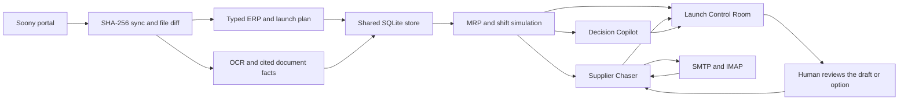

# Soony Launch Control Room

Team Manti’s private START Hack prototype for the Soony Grand Heist 6 launch at DC-HAM. The control room reconciles supplier, ERP and receiving evidence, forecasts the two packing lines, and queues supplier follow-ups and decisions.

## Run locally

The [supplied case snapshot](case-data/) contains all 308 files verified against the team portal on 21 November 2026, including the staged supplier drop. The offline commands below use this snapshot directly from the checkout.

Requires Python 3.10+, SQLite 3.37+ and Tesseract. Install the Polish, Korean and Simplified Chinese language packs for full scan coverage. On macOS, `brew install tesseract tesseract-lang` supplies the OCR tools. Linux installations need the corresponding Tesseract language packages.

```sh
python3 -m venv .venv
source .venv/bin/activate
python3 -m pip install -r requirements.txt
python3 -m src.orchestrator --data case-data
```

On Windows (PowerShell), install Tesseract with `winget install UB-Mannheim.TesseractOCR` and add `C:\Program Files\Tesseract-OCR` to `PATH`. Without Tesseract the app still runs but misses handwritten receipt corrections such as the art-book booking error. Then:

```powershell
python -m venv .venv
.venv\Scripts\Activate.ps1
python -m pip install -r requirements.txt
python -m src.orchestrator --data case-data
```

Open **http://127.0.0.1:8787/live**. Initial OCR may take a couple of minutes. The separate React prototype can be built with `npm --prefix web ci` and `npm --prefix web run build`. The shared store is `store/soony.db` and the service resumes from it. For a one-time JSON snapshot, run `python3 -m src.orchestrator --once --data case-data`.

- **Portal polling** requires the private team token in `.soony_token` or `SOONY_TOKEN`. Run `python3 -m src.orchestrator --online` to sync every 45 seconds and ingest by SHA-256. Use `python3 bridge/sync.py` for a manual download.
- **Replay** uses `python3 -m src.orchestrator --demo --data case-data`. It creates a disposable database and a private copy of the local inputs, stages downloaded shipping advices and rush offers, and applies them on the next manual sync. The supplier send and demo reply actions stay in the replay database.
- **LLM** is optional. Set `SOONY_LLM_MODEL` for document translation/reply interpretation and `SOONY_LLM_VISION_MODEL` for image extraction. Use `SOONY_LLM_URL` for the chat-completions endpoint (default Ollama `http://127.0.0.1:11434/v1/chat/completions`) and `SOONY_LLM_API_KEY` for an authenticated OpenAI-compatible endpoint. `SOONY_LLM_PROVIDER=none` disables model calls. Legacy `SOONY_LOCAL_MODEL`, `SOONY_VISION_MODEL`, `SOONY_LOCAL_URL` and `SOONY_LOCAL_API_KEY` names remain accepted. Remote URLs require `SOONY_LLM_ALLOW_REMOTE=1`. Model facts require source quotes, responses are cached under `store/llm_cache`, calls are logged to `store/llm_log.jsonl`, and `SOONY_LLM_CALL_BUDGET` caps calls per cycle (default 20). Run `python3 -m src.llm.check` for a live extraction proof.
- **Mailbox** ([setup guide](docs/REAL_EMAIL.md)) uses `CHASER_REAL_SMTP=1`, a portal-registered `CHASER_SENDER`, `CHASER_SMTP_HOST`, optional `CHASER_SMTP_PORT`, and `CHASER_SMTP_USERNAME` / `CHASER_SMTP_PASSWORD` where required. Replies use `SOONY_IMAP_HOST`, `SOONY_IMAP_USER`, `SOONY_IMAP_PASSWORD` and optional `SOONY_IMAP_PORT`. Each message requires human confirmation, and real mail only goes to the case supplier domain (`CHASER_ALLOWED_DOMAINS`). Supplier claims await review and purchase commitments require the PP-07 signers.

## Architecture



Rows have source positions. Document facts carry the filename, page and original quote. A shared-component simulation advances in 30-minute buckets with route transit, last-mile transport, handling delays and scheduled shift capacity. The displayed probabilities are scenario frequencies under those assumptions. Shipment quantities come from shipment evidence such as the launch plan and shipping advices. A purchase order can span multiple shipments.

The API is loopback only. `GET /api/dashboard` drives the UI, `GET /api/truth` exports readiness and the forecast inputs, and `GET /api/documents` returns extracted evidence. `GET /api/source/<path>` opens source evidence from the local mirror. `POST /api/sync` schedules a refresh or releases the staged drop in replay. Approval and thread actions are described in [DECISIONS.md](coord/DECISIONS.md).

Keep `data/`, `store/`, browser and model caches, and credentials inside the team workspace. [Findings](private/FINDINGS.md) records source references. [Demo and business case](private/submission/DEMO.md) covers the walkthrough and break-even assumptions.
