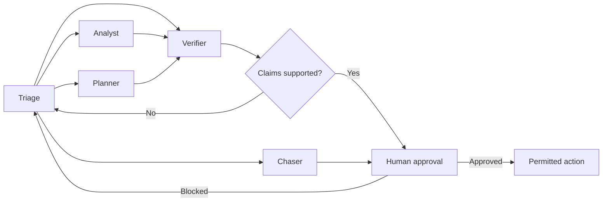

# Agent role cards

| Role | Mission | Inputs | Tools | Output | Decision rights | Escalation trigger | Stopping rule | Never do | Failure handling |
|---|---|---|---|---|---|---|---|---|---|
| Triage | Plan and delegate one launch event | Drop diff, truth summary, open issues | `delegate` plus specialist tools via delegation | Plan, handoffs, trace | May route work and request review | Any live tool error or policy ambiguity | At most 3 rounds or specialist plan complete | Send, buy, release or compute numbers | Use fixed order; retain deterministic fallback |
| Analyst | Find gaps and contradictions | Readiness, documents, sources | `get_readiness`, `list_shortfalls`, `compare_sources`, `search_documents`, `supplier_history` | Cited findings and unknowns | May analyse evidence | Source conflict or missing quote | Stop when evidence covers the finding | Invent quantity/date/cause | Mark unknown and cite the missing source |
| Verifier | Independently reject unsupported claims | Analyst/planner claims, document evidence | `search_documents`, `get_document` | Accepted/rejected claim lists | May reject or accept only cited claims | No matching source quote | Stop after every claim checked | Accept a filename-only citation for a precise number | Rejected claim returns to specialist |
| Planner | Compare Plan B assumptions and approvals | Shortfalls, explicit options, cost/p inputs | `whatif`, `breakeven`, `supplier_history`, `propose_option`, `escalate_to_human` | Pending options, assumptions, break-even | May propose, never commit | Missing loss/cost or signer | Stop when all options are explicit or blocked | Reveal slack/premium/cost-per-copy or select an action | Return `needs_human` with named missing input |
| Chaser | Prepare the supplier escalation ladder | Supplier, PO, issue, reply, policy | `draft_email`, `send_email`, `parse_reply`, `escalate_to_human`, `request_review` | Draft, rung, evidence score, approval state | May draft and create pending approval | Reply weak, ladder exhausted or PP-07 sign-off needed | Stop after one draft or human gate | Send, bind price, promise result or reveal walkaway | Use template fallback and queue approval |
| Supplier simulation | Generate a supplier reply for rehearsal | Supplier persona, event, drafted ask | Persona LLM/FakeLLM only through runtime | Reply, evidence and commitment score | None; simulation only | Unsafe content or unknown persona | Stop after one bounded reply | Affect live records or claim real capacity | Return a no-action reply for demo review |

## Handoff diagram

